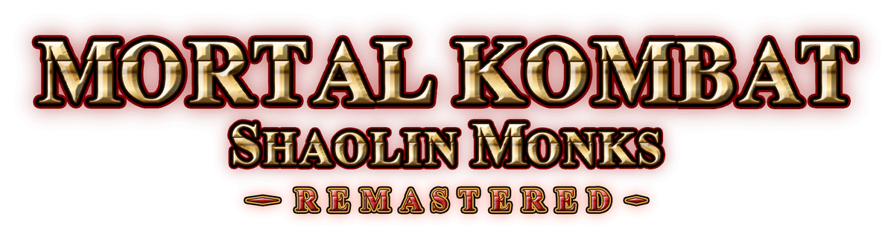
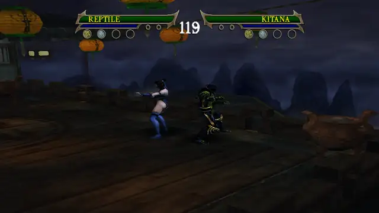
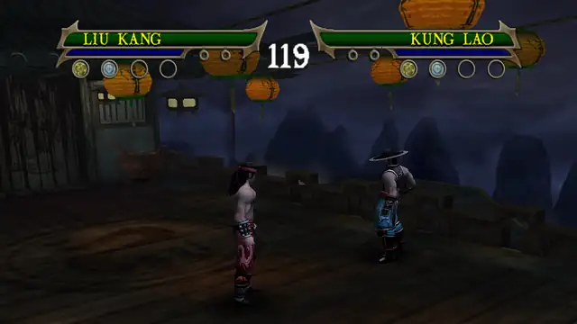
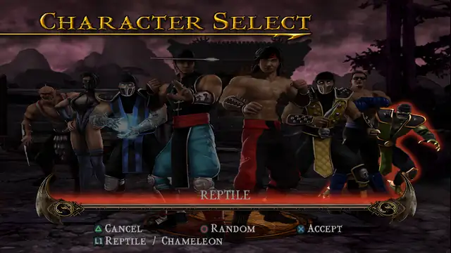

<p align="center">
  
</p>

<p align="center">
  <a href="#install-linux"></a>
  <a href="#play-in-the-browser"></a>
  
  
  
  
  <a href="LICENSE"></a>
</p>


**Two monks, one couch or one link: the PS2 classic, recompiled and remastered.**

Mortal Kombat: Shaolin Monks (PS2, NTSC-U, `SLUS_210.87`), statically recompiled to run natively on Linux and in the
browser, with a graphics remaster (3x6 supersampling, 16:9 widescreen, HD textures) and two-player co-op, locally and
online.

## What's new

### Fully playable online

<p align="center"></p>

The whole game, Story, Ko-op and Versus, with a friend over the internet, right in the browser. Share your code or link, and
they join at any time, even mid-level. Both browsers run the game in lockstep. See
[Online co-op](#online-co-op).

### 8 fighters, all with combo and special upgrades

<p align="center"></p>

Liu Kang, Kung Lao, Scorpion and Sub-Zero are joined by Reptile, Baraka, Kitana and Johnny Cage, all playable in Story,
Ko-op and Versus. All eight buy combo and special upgrades with Experience. The four who were Versus-only get the story
fighters' combo extensions, plus new specials on R1 + L1 taken from their story versions: Reptile turns invisible and
gets the boss's counter; Baraka gets a blade slash and a leaping counter; Johnny Cage a counter
flip kick; Kitana borrows her sister Mileena's low sweep. Each one has a page with every move, combo and a clip:
[docs/characters](docs/characters/README.md).

### New secret character: Chameleon

<p align="center"></p>

Reptile's story costume hides a new fighter. At the select screen, press L1 (or L3) on Reptile to turn him into
Chameleon, with his rainbow colours always cycling. In a fight, L3 switches his mode: yellow fights with Scorpion's
specials and stance, blue with Sub-Zero's. His page: [docs/characters/chameleon](docs/characters/chameleon/README.md).

## Install (Linux)

```sh
git clone https://github.com/Darkosxl/mksm-recomp.git && cd mksm-recomp && ./install.sh /path/to/MKSM.iso
```

`install.sh` checks what the build needs and says what is missing: clang 17+ or GCC 13+, CMake, Ninja, Python 3, curl,
unzip and the SDL2 development files. To play you also need a GPU with a Vulkan driver. Then it builds the game
(`--jobs N` sets the compile jobs, default 4) and prints how to start it; `--play` starts it right away.

## Play

```sh
remaster/play.sh               # the remaster
remaster/play.sh --original    # the original look, same build and memory card
```

- Arguments after these go to the game: `--fullscreen` starts in fullscreen, and F11 switches.
- `PS2_SCALE=2x4 remaster/play.sh` renders at a lower resolution, for slower GPUs.
- HD textures are optional and not included. With a texture pack, run `PS2_TEX_PACK=/path/to/pack remaster/play.sh`.
- Saves are kept on the memory card `games/mksm/card.ps2`.

## Play in the browser

Open your invite link to **`https://<our-domain>`**. The site is invite-only. It needs desktop Chrome or Edge (WebGPU
and WebAssembly JSPI). On Linux, first turn on `chrome://flags/#enable-unsafe-webgpu` and
`chrome://flags/#enable-vulkan` and restart the browser.

- The first visit asks for a nickname. **Play** starts your own game, and **Play offline** starts a game nobody can
  join.
- **Quality**: Auto picks the remaster at 3x6 and lowers it on the next start if your computer can't hold 60 fps. You
  can also pick a level yourself, down to Original.
- HD textures load while you play and are kept by the browser.
- Saves stay in this browser. **Export card** and **Import card** move them as a `.ps2` file.

## Local co-op (two players, one machine)

Pick Ko-op in the game's menus. The keyboard is always player 1. The browser works the same way with **Play offline**.

- **Two controllers**: plug both in. The first is player 1 (with the keyboard), the second is player 2.
- **Keyboard and a controller**: turn co-op on. On the desktop that is `remaster/play.sh --coop` (`--pad2` also
  works). In the browser, press **Co-op off** on the game's bar so it says **Co-op on**. The browser remembers it.
  The keyboard is player 1 and the controller is player 2. A second controller then joins the keyboard as player 1.
- A controller keeps its player while it stays connected.
- In a game with a code, each browser has one player: the keyboard and the first controller.

## Online co-op

In the browser, **Play** shows your code (`ABCD-EFGH`) and a link to copy. Your friend types the code into **Join** or
opens the link. They can join at any time, even mid-level, and the game uses your memory card. Their own saves are not
touched.

Desktop builds have their own online modes. See [Development](#development).

## Controls

<!-- KEYBOARD CONTROLS: the one place for the key table. The keys themselves are in host/window.cpp (kKeys, and the
     stick keys in poll_port), web/input.js (keyMap, stickKeys; its legend() feeds the landing page's controller
     check) and web/netplay.html (KEYS). The layout is OAleex's Shaolin Monks recomp's. Change the code and this table
     together. -->

The keyboard is player 1, on the desktop and in the browser.

| PS2 | Keyboard |
|---|---|
| Left stick | W A S D |
| D-pad | Arrow keys |
| Cross | Space |
| Circle | Esc (also Ctrl on desktop) |
| Square | J |
| Triangle | K |
| L1 / R1 | Q / C |
| L2 / R2 | Shift / E |
| Start | Enter |
| Select | Backspace |
| Fullscreen | F11 (desktop), F (browser) |

In browser fullscreen, hold Esc to leave fullscreen.

<!-- END KEYBOARD CONTROLS -->

Controllers use the usual layout:

- The bottom, right, left and top face buttons are cross, circle, square and triangle.
- The bumpers are L1 and R1.
- The triggers are L2 and R2, and they are pressure-sensitive.
- The sticks and stick clicks work as on a DualShock 2.
- Controllers that have motors vibrate.

---

## Development

### Status

| Area | State |
|---|---|
| Desktop | Boots and plays: Story levels, local Ko-op and Versus. An automated sweep warped to all 107 maps with no crash or halt (`mksm/notes/m5-sweep.md`). The maps that went black there were fixed or shown to match PCSX2 (`mksm/notes/black-maps.md`). Saves load in PCSX2 and back (`mksm/notes/pcsx2-crosscheck.md`). A full Story playthrough by a person is still open (`mksm/notes/BLOCKERS.md`). |
| Remaster | 60 fps at 3x6 with the hardware GS renderer on a laptop RTX 4050 (noted in `remaster/play.sh`, commit dbecd34). Pre-rendered movies stay 4:3. Step log: `mksm/notes/remaster.md`. |
| Browser | The original game at native resolution: 60 fps on an NVIDIA GPU (`mksm/notes/web-build.md`). The remaster at 3x6: 60.0 fps mean at the Foundry, measured headless on the same RTX 4050 (commit 5bbe284). |
| Online co-op | Browser lockstep: a 22-minute two-browser run (NVIDIA host, Intel iGPU guest) with zero desyncs under injected faults (`mksm/notes/web-lockstep.md`). Desktop lockstep uses the same protocol and was tested on localhost (`mksm/notes/native-lockstep.md`). |
| Decomp | In progress. See [decomp/README.md](decomp/README.md). |

### Layout

| Path | What |
|---|---|
| `install.sh` | One-step desktop install: checks prerequisites, then runs `mksm/build.sh`. |
| `mksm/` | Everything specific to this game: `build.sh`, the generated C++, entry seeds, `patches/widescreen.pnach`, scripted inputs, tools and notes. See [mksm/README.md](mksm/README.md). |
| `mksm/notes/` | Build journal, fix queue (`BLOCKERS.md`), the remaster log (`remaster.md`), web build, lockstep and host-mode notes. |
| `remaster/` | `play.sh`, texture dump/upscale/pack scripts, regression gates, recording. |
| `decomp/` | The functional decomp: [decomp/README.md](decomp/README.md). |
| `server/` | Invite-only web hosting, signalling, lobby page and host mode: [server/README.md](server/README.md). |
| `web/` | The browser page (`shell.html`), lockstep co-op (`lockstep.js`, protocol in `lockstep.md`), input, disc cache and texture pack streaming. |
| `recomp/`, `runtime/`, `host/` | The recompilers (`eerecomp`, `vurecomp`), the emulated console, and the `ps2run` and web entry points. |
| `scripts/` | Toolchain setup, the web build, a local server (`serve.py`), disc image tools. |
| `docs/netplay.md` | Streaming co-op (`--host`). |

### Building by hand

```sh
mksm/build.sh /path/to/MKSM.iso [--jobs N] [--retranslate] [--web]
build/native-mksm/ps2run games/mksm/disc/SLUS_210.87 --disc games/mksm/disc.iso --window --memcard games/mksm/card.ps2
```

`mksm/build.sh` does the following:

- Links the image as `games/mksm/disc.iso` and extracts `SYSTEM.CNF` and `SLUS_210.87`.
- Applies the Ko-op fix (`mksm/tools/scripts/patch_koop.py`) to the known dump's ELF. That dump is an unlock-all build whose mod breaks Ko-op; other ELFs are left alone.
- On the first run, builds the recompilers and fetches wgpu-native.
- Compiles the committed C++, which was translated from that dump.

The flags:

- `--retranslate` regenerates `mksm/generated/` from your ELF.
- `--web` makes the browser build in `build/web-mksm`. On the first run it clones the Emscripten SDK 6.0.11 into `tools/emsdk`, so it also needs git.
- `python3 scripts/serve.py build/web-mksm games/mksm/disc.iso [--pack <dir>]` serves the build on http://localhost:8620/.

The optional libraries are picked up at configure time. Each one turns on a feature:

| Library | Feature |
|---|---|
| zlib | Lockstep co-op |
| OpenSSL | `wss://` for desktop co-op |
| libdatachannel | WebRTC for desktop co-op |
| libdatachannel, FFmpeg and Opus | Streaming co-op (`--host`) |
| SoundTouch | Time-stretched sound below full speed |

### Hosting and desktop online co-op

| What | Where |
|---|---|
| The invite-only site: Caddy, `signal.mjs` and coturn, deployed with `server/deploy.sh` | [server/README.md](server/README.md) (Node 20+; tests: `cd server && npm install && node test.mjs`) |
| Host mode without a server: your PC serves the web build through a Cloudflare quick tunnel | `mksm/host.sh`, guide in `mksm/notes/web-host.md` |
| Desktop lockstep: `ps2run ... --invite '<invite link>'` or `--lockstep wss://<server> --room new\|<id>` | `mksm/notes/native-lockstep.md` |
| Streaming co-op: only the desktop host runs the game, and a browser plays controller 2 | [docs/netplay.md](docs/netplay.md) |

Lockstep peers must agree on the build and on settings that change the game (the widescreen patch, `PS2_DECOMP`).
Otherwise the handshake refuses them. Render-only settings such as the scale may differ.

### Remaster settings

`remaster/play.sh` sets the environment for `ps2run`:

| Setting | What it does |
|---|---|
| `PS2_SCALE=3x6` | Renders 3 samples across and 6 down per PS2 pixel, so MK:SM's 224-line fields become full 1920x1344 frames. `N` alone is a square scale. |
| `PS2_PNACH=mksm/patches/widescreen.pnach`, `PS2_ASPECT=16:9` | Widescreen (Hor+) through the game's own aspect variable. HUD, menus and movies stay 4:3. This patches the game. |
| `PS2_TEX_PACK=<dir>` | HD texture pack. `play.sh` uses `remaster-data/textures/pack-v2` two directories above the checkout when that exists. |
| `PS2_GS_HW=1` | The hardware GS renderer (`0`: the compute one). |
| `PS2_FIELD_FLAG=...` | Lines up the game's interlaced fields exactly at the higher scale. |

Making an HD pack from your own game takes three steps:

1. Dump the textures with `remaster/texdump.sh` or `remaster/harvest.sh`. Both start from savestates made by `remaster/make_states.sh`.
2. Upscale them with `remaster/upscale.py <dump> <pack>`. It needs `realesrgan-ncnn-vulkan` in `tools-remaster/realesrgan/`, two directories above the checkout.
3. Convert the pack for the web with `remaster/webpack.py <pack> <out> --scale 4|2`.

Regression gates, GPU checks, profiling and the AWS workflow are described in `mksm/notes/remaster.md` and
[decomp/README.md](decomp/README.md).

### Upstream

Built on [ps2-web-recomp](https://github.com/snuri00/ps2-web-recomp) by Samir Nuri, the sibling of
[psp-web-recomp](https://github.com/snuri00/psp-web-recomp), and its method:

- The EE executable is statically recompiled to C++.
- VU1 microprograms are compiled ahead of time.
- The IOP runs the game's own modules on an R3000 interpreter with a reimplemented IOP kernel.
- The Graphics Synthesizer is emulated on the GPU through WebGPU.

Its generic flow for other games, `scripts/port.sh`, is still in the tree. This game builds with `mksm/build.sh`.

## Credits

The MPEG decoder's VLC tables are adapted from [Play!](https://github.com/jpd002/Play-) (BSD 2-clause, notice in
`runtime/src/ipu/NOTICE`). PCSX2, Play! and the ps2sdk headers were references for the emulated hardware and system
behaviour, and PCSX2 is the oracle the recomp is checked against. wgpu-native and Dawn provide WebGPU on the desktop and
in the browser, and Emscripten builds the WebAssembly.

## License

The code is under the MIT License, see [LICENSE](LICENSE); `runtime/src/ipu/tables.hpp` keeps Play!'s BSD 2-clause
notice. The license does not cover `mksm/generated/`, which is translated from the game's executable and belongs to its
owners. Mortal Kombat and PlayStation are trademarks of their respective owners; this project is not affiliated with or
endorsed by them.
