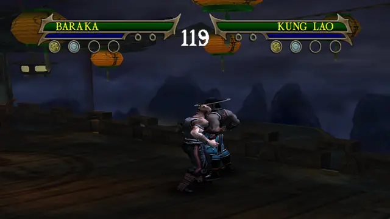
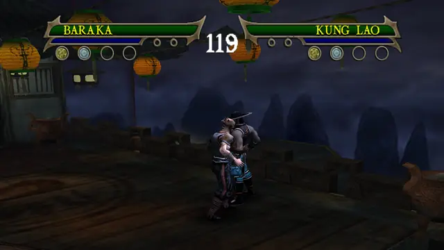

# Baraka

Versus-only in the original game. This build adds the story fighters' combo extensions to his strings and gives him
two of the story boss Baraka's moves on R1 + L1. General notes (buttons, upgrades, damage): [Fighters](../README.md).

## Special moves

Hold R1 and press the button. Each special has five upgrade levels in the move data. Every level plays the same move,
so in story you need level 1 to use it.

### R1 + square: Blade Spark

Fires a bolt of energy at the opponent. Damage 17.

### R1 + triangle: Bladed Uppercut

A vicious uppercut with his arm blades. Damage 25.

### R1 + circle: Scissor Attack

Chops into the opponent with both blades and holds him up on them for a dozen quick hits. Damage 48 in 12 hits.

### R1 + R2: Dragon Grapple

Grabs the opponent to carry, throw or attack. While holding him: square for Run Off Back, triangle for Flip Up (the
clip), circle for Power Slam, or a direction + R2 for Directional Throw (story and Ko-op only).
Damage 12 with Flip Up.

<!-- BM-BARAKA: merge point for branch bm-baraka. It adds docs/characters/baraka/moves.md and the clips of his new
     boss specials; link or inline them here. -->
## Boss moves: R1 + L1

Two moves of the story boss Baraka, from branch `bm-baraka` (details in [moves.md](moves.md)). Hold R1 and L1, then
press the button. L1 does nothing else in a fight, so R1 + button stays his own special. Each needs the level of his
special on the same button. R1 + L1 + circle and R1 + L1 + R2 play his own specials.

### R1 + L1 + square: blade slash

He steps back while slashing (state 1507), so it only hits a close opponent. Damage 20 when he starts close, 0 from the fight-start distance (bm-baraka's runs).

### R1 + L1 + triangle: leaping counter

He leaps in blade first, lands and returns to his stance (the boss's counter, state 1480). Damage 30 from the fight-start distance (bm-baraka's runs).

<!-- /BM-BARAKA -->

## Combos

Square is the quick attack, circle the power attack and triangle the launcher. Most attacks can also be cancelled
into another attack or a special during their cancel window, so the strings below are the fixed ones from the move
data, not the only chains.

### His own strings (Versus, story and Ko-op)

| Input | Notes |
|---|---|
| triangle, R2 | Bladeflip, in the game's move list |
| triangle, triangle | |
| square, triangle, circle | |
| square, square, circle, circle | |
| square, square, square, R2 | ends in his counter (d10) |

### Ported combo extensions (Versus, story and Ko-op)

From the story fighters' Experience combos (`mksm/tools/scripts/vsfallback.py`, donors Kung Lao, Sub-Zero, Liu Kang,
Scorpion). In story each needs the combo upgrade shown; Versus has them all. Damage is the best of the five press
gaps in the damage audit (`vsaudit.py`).

| Input | Upgrade | Damage |
|---|---|---|
| triangle, circle | C2 | 40 |
| triangle, circle, R2 | C2 | 70 |
| triangle, circle, circle | C2 | 50 |
| triangle, circle, triangle | C2 | 40 |
| triangle, circle, square | C2 | 40 |
| triangle, square | C1 | 18 |
| triangle, square, square | C1 | 26 |
| square, square, square, triangle | C1 | 28 |

Triangle, circle, R2 does 70 with quick presses (8 frames apart) and 40 when slower.

Square, square, triangle stays as in the original game: the port there did less damage than his own follow-up
(`vsfallback.py`, DROP).

### Story and Ko-op only

These start with the stick held, so they never start in Versus (see [Fighters](../README.md#moves-that-need-a-direction-story-and-ko-op-only)).
"Stick" is sideways or back, relative to the opponent.

| Input | Upgrade |
|---|---|
| stick + square, square, square, R2 | his own |
| stick + triangle, then triangle or R2 | his own |
| stick + triangle, square, square | C1 |
| stick + triangle, circle, then circle, triangle, square or R2 | C2 |
