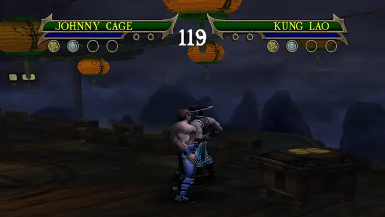
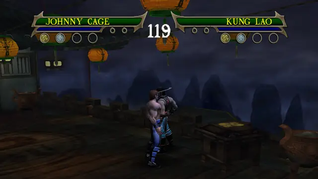

# Johnny Cage

Versus-only in the original game. This build adds the story fighters' combo extensions to his strings and gives him
the story mode's Cage's counter flip kick on R1 + L1. General notes (buttons, upgrades, damage): [Fighters](../README.md).

## Special moves

Hold R1 and press the button. Each special has five upgrade levels in the move data. Every level plays the same move,
so in story you need level 1 to use it.

### R1 + square: Sonic Ball

A ball of sonic energy. Press square again, up to twice, for more. Damage 45 in 3 hits.

### R1 + triangle: Shadow Uppercut

His signature uppercut. Damage 25.

### R1 + circle: Shadow Kick

His signature shadow kick. Damage 30.

### R1 + R2: Enemy Manipulation

Grabs the opponent and holds him. Cross lets go. No damage on a standing opponent in the test run.

<!-- BM-CAGE: merge point for branch bm-cage. It adds docs/characters/cage/moves.md and the clips of his new boss
     specials; link or inline them here. -->
## Story Cage's move: R1 + L1

A move of the story mode's own Johnny Cage, from branch `bm-cage` (details in [moves.md](moves.md)). Hold R1 and
L1, then press the button. L1 does nothing else in a fight, so R1 + button stays his own special.

### R1 + L1 + square: counter flip kick

A flipping kick in the air (`d10_cntr`), then he lands and returns to his stance. Damage 10 (bm-cage's run).

<!-- /BM-CAGE -->

## Combos

Square is the quick attack, circle the power attack and triangle the launcher. Most attacks can also be cancelled
into another attack or a special during their cancel window, so the strings below are the fixed ones from the move
data, not the only chains.

### His own strings (Versus, story and Ko-op)

| Input | Damage |
|---|---|
| triangle, circle, R2 | 81 |
| triangle, circle, circle | 74 |
| triangle, circle, square | 51 |
| triangle, triangle, circle | |
| square, square, circle, circle | |

The triangle, circle strings run through his cancel windows. They hit hardest with the presses 16 to 26 frames apart.

### Ported combo extensions (Versus, story and Ko-op)

From the story fighters' Experience combos (`mksm/tools/scripts/vsfallback.py`, donors Liu Kang, Scorpion, Kung Lao,
Sub-Zero). In story each needs the combo upgrade shown; Versus has them all. Damage is the best of the five press
gaps in the damage audit (`vsaudit.py`).

| Input | Upgrade | Damage |
|---|---|---|
| square, square, square, R2 | C5 | 46 |
| triangle, square | C1 | 16 |
| triangle, square, square | C1 | 16 |

Square, square, square, triangle, square, square, triangle and every triangle, circle extension stay as in the
original game: the ports there did less damage than his own follow-ups (`vsfallback.py`, DROP).

### Story and Ko-op only

These start with the stick held, so they never start in Versus (see [Fighters](../README.md#moves-that-need-a-direction-story-and-ko-op-only)).
"Stick" is sideways or back, relative to the opponent.

| Input | Upgrade |
|---|---|
| stick + triangle, triangle | his own |
| stick + square, square, square, R2 | C2 |
| stick + triangle, square, square | C1 |
