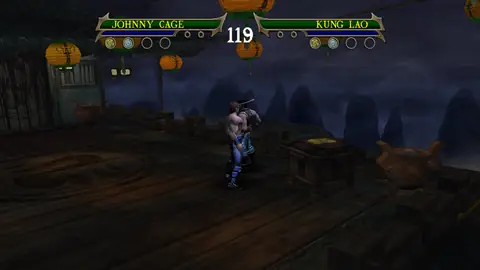

# Johnny Cage: moves borrowed from the story Cage

Versus Johnny Cage gets a move from the story mode's own Johnny Cage, the fighter you meet in the story levels
(group 71: the same model and the same 50-bone skeleton as Versus Cage). Like Reptile's boss moves, it needs the
`PS2_MOD` gameplay mods.

Hold **R1** (Special) and **L1**, then tap the button. L1 does nothing else in Versus, so this layer does not take
any of his own moves: R1 + button is still his own special.

| Input | Move | Damage |
|---|---|---|
| R1 + L1 + Square | Counter flip kick (`d10_cntr`): a flipping kick in the air that hits on frame 5, then he lands and returns to stance | 10 |

Damage is the opponent's health loss (of 250) in a headless Versus run against Kung Lao from the fight-start
distance.

Clip inputs (from a Versus fight-start state of Johnny Cage vs Kung Lao, fight start frame 3720; `remaster/vsrun.sh raw`
press syntax `frame:button:frames held`):

| Move | Presses | Story Cage state plays | Back in stance |
|---|---|---|---|
| R1 + L1 + Square | `3728:r1:30 3732:l1:26 3740:square:4` | 1916, frames 3741-3804 (64), hit on 3746, then landing (common state 7) for 28 | 2831 (`a00_stnd`) from frame 3833 |

The clip below is a preview from the box's software renderer.

Not ported: the story Cage's death fall (`t00_deth`) and his standing taunt (`sn40_ger`, no hit). His vanish (`t20_sung` / `t10_sung`) was ported, then
dropped. The other story Cage clips are the same as his own.
