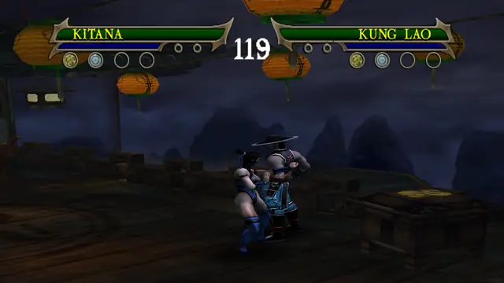
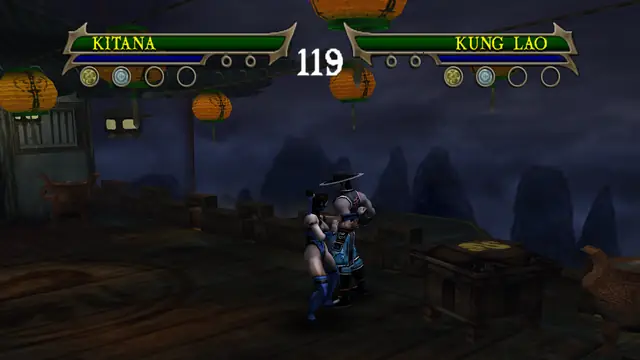

# Kitana

Versus-only in the original game. This build adds the story fighters' combo extensions to her strings, and borrowed
boss specials are on the way. General notes (buttons, upgrades, damage): [Fighters](../README.md).

## Special moves

Hold R1 and press the button. Each special has five upgrade levels in the move data. Every level plays the same move,
so in story you need level 1 to use it.

### R1 + square: Air Jump

Vaults high into the air. No damage on a standing opponent in the test run.

### R1 + triangle: Fan Lifter

Lifts the opponent off the ground with rapid fan movements. Damage 10.

### R1 + circle: Fan Throw

Throws her fans at the opponent. Damage 20.

### R1 + R2: Enemy Manipulation

Grabs the opponent and holds him. Cross lets go. No damage on a standing opponent in the test run.

<!-- BM-KITANA: merge point for branch bm-kitana. It adds docs/characters/kitana/moves.md and the clips of her new
     boss specials; link or inline them here. -->
## Borrowed boss specials

In progress on branch `bm-kitana`: new specials borrowed from a story boss. They will be described in
[moves.md](moves.md).
<!-- /BM-KITANA -->

## Combos

Square is the quick attack, circle the power attack and triangle the launcher. Most attacks can also be cancelled
into another attack or a special during their cancel window, so the strings below are the fixed ones from the move
data, not the only chains.

### Her own strings (Versus, story and Ko-op)

| Input | Name in the game's move list |
|---|---|
| square, square, square, circle | Fan Flurry |
| triangle, triangle, circle | Wind Wave |

### Ported combo extensions (Versus, story and Ko-op)

From the story fighters' Experience combos (`mksm/tools/scripts/vsfallback.py`, donors Kung Lao, Scorpion, Liu Kang,
Sub-Zero). In story each needs the combo upgrade shown; Versus has them all. Damage is the best of the five press
gaps in the damage audit (`vsaudit.py`).

| Input | Upgrade | Damage |
|---|---|---|
| square, square, square, R2 | C4 | 75 |
| square, square, circle | C3 | 40 |
| triangle, square | C1 | 18 |
| triangle, square, square | C1 | 30 |
| triangle, circle | C2 | 38 |
| triangle, circle, then circle, triangle, square or R2 | C2 | 38 |

Square, square, square, R2 ends in a throw. It does 75 when the R2 comes about 26 frames after the third square, and
about 40 when it comes sooner.

Square, square, square, triangle and square, square, triangle stay as in the original game: the ports there did less
damage than her own follow-ups (`vsfallback.py`, DROP).

### Story and Ko-op only

These start with the stick held, so they never start in Versus (see [Fighters](../README.md#moves-that-need-a-direction-story-and-ko-op-only)).
"Stick" is sideways or back, relative to the opponent.

| Input | Upgrade |
|---|---|
| stick + circle | her own |
| stick + R2 | her own throw in that direction |
| back + square, square, square, triangle | her own |
| stick + square, square, square, R2 | C4 |
| stick + triangle, circle, then circle, triangle, square or R2 | C2 |
