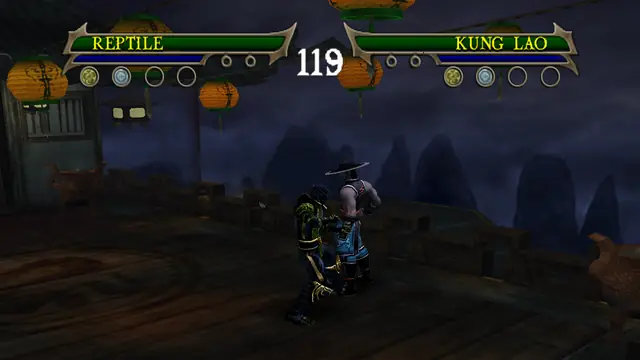
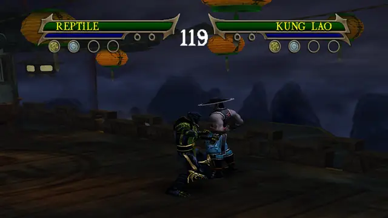

# Reptile

Versus-only in the original game. This build adds the story fighters' combo extensions to his strings and gives him
two of the story boss Reptile's moves on R1 + L1. Chameleon is a variant of him: see [Chameleon](../chameleon/README.md).
General notes (buttons, upgrades, damage): [Fighters](../README.md).

## Special moves

Hold R1 and press the button. Each special has five upgrade levels in the move data. Every level plays the same move,
so in story you need level 1 to use it.

### R1 + square: Acid Spit

Spits acid at the opponent. Damage 20.

### R1 + triangle: Slide Attack

Slides along the ground and launches the opponent into the air, leaving a pool of acid. Damage 20.

### R1 + circle: Force Ball

A ball of green energy that launches the opponent into the air. Damage 25.

### R1 + R2: Dragon Grapple

Grabs the opponent to carry, throw or attack. While holding him:

- square: Run Off Back
- triangle: Flip Up, throws him up into the air (the clip)
- circle: Power Slam
- a direction + R2: Directional Throw (story and Ko-op only, see below)

Damage 12 with Flip Up.

## Boss moves: R1 + L1

The story boss Reptile's moves (`mksm/tools/scripts/vsboss.py`, `decomp/src/mod/versus_boss_moves.cpp`). Hold R1
and L1, then press the button. L1 does nothing else in a fight, so R1 + L1 is a free layer over his own specials.
Each boss move copies the level requirement of one of his specials: triangle needs Slide Attack, R2 needs Acid Spit.
They work in every mode.

### R1 + L1 + triangle: Invisibility (press again to reappear)

The boss's invisibility (state 1586). He fades out in a burst of green particles and stays invisible, through his
combos, until you press R1 + L1 + triangle again. The clip presses it twice, about 3 s apart.

### R1 + L1 + R2: the boss's counter

The boss's counter, d30 (state 1578), as its own move.

Not ported (`vsboss.py`, DROPPED): the boss's acid volley (s50, 1588) and s40 (1587), whose projectiles never hit a
Versus opponent, and s11 (1584), g20 (1581) and g10 (1580), which keep their travel in the clip's root bone, so the
fighter's position would only catch up when the move ends.

## Combos

Square is the quick attack, circle the power attack (hold it to charge) and triangle the launcher. Most attacks can
also be cancelled into another attack or a special during their cancel window, so the strings below are the fixed
ones from the move data, not the only chains.

### His own strings (Versus, story and Ko-op)

| Input | Ends in |
|---|---|
| square, square, square, circle | counter (d10) |
| triangle, circle | g10 |
| triangle, triangle, circle | counter (d30) |
| triangle, square, square, circle | g21 |

### Ported combo extensions (Versus, story and Ko-op)

From the story fighters' Experience combos (`mksm/tools/scripts/vsfallback.py`, donors Sub-Zero, Liu Kang, Kung
Lao, Scorpion). In story each needs the combo upgrade shown; Versus has them all.

| Input | Upgrade | Damage | New hit |
|---|---|---|---|
| square, square, square, triangle | C1 | 28 | triangle plays k12 |

Three strings stay as in the original game, because the ports there did less damage than his own follow-ups
(`vsfallback.py`, DROP): square, square, circle; square, square, square, R2; and square, square, triangle. The last
port did 48 with the triangle about 20 frames after the second square, but 10 at every other press gap, against 19
without it.

### Story and Ko-op only

These start with the stick held, so they never start in Versus (see [Fighters](../README.md#moves-that-need-a-direction-story-and-ko-op-only)).
"Stick" is sideways or back, relative to the opponent.

| Input | Upgrade |
|---|---|
| stick + square, square, square | his own |
| stick + triangle, triangle | his own |
| stick + triangle, square, square | C1 |
| stick + triangle, circle, then circle, triangle, square or R2 | C2 |
| stick + R2 | his own directional throw |
| circle held, released with the stick | his own charged power attacks |
