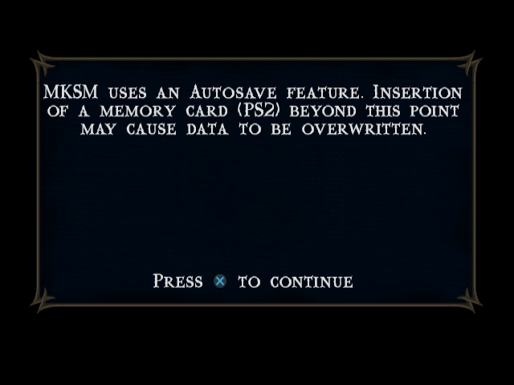

# PCSX2 oracle: first boot capture (SLUS-21087, MK: Shaolin Monks v1.02)

- Run: 2026-10-15, `tools/scripts/oracle_boot.sh` equivalent:
  `timeout 150 pcsx2-qt -datapath oracle/pcsx2-data -nogui -fastboot -earlyconsolelog -logfile logs/pcsx2-boot.log -- iso/mksm.iso`
- PCSX2 v2.9.45, BIOS **USA v02.30 (20/02/2008)** `ps2-0230a-20080220.bin` (symlinked), fast boot, OpenGL renderer (auto; Vulkan skipped for Intel ADL GT2), Wayland/EGL.
- Exit code **124** (timeout); PCSX2 handled SIGTERM gracefully ("Received CTRL+C, attempting graceful shutdown"), saved NVRAM, released memory.
- Raw log: `logs/pcsx2-boot.log` (508 lines). A first attempt with the wrong data-root layout is kept at `logs/pcsx2-boot.attempt1-wrongdatapath.log` (it ran with defaults, no BIOS, and was killed).
- Game CRC **5C8A2D7F**, ELF entry **0x0011C070**, ELF `cdrom0:\SLUS_210.87;1` 4,934,152 bytes, loaded `00100000..004b1f94`.
- GameDB fixes applied by PCSX2 (relevant for oracle fidelity): GS `halfPixelOffset=5`, `autoFlush=2` (GS-side only; no EE/VU gamefixes).

## Data-dir gotcha

`-datapath X` makes the DataRoot **`X/PCSX2`**, not `X`. The real ini is
`oracle/pcsx2-data/PCSX2/inis/PCSX2.ini`; `oracle/pcsx2-data/inis` is a symlink to it.
All folders that matter are absolute paths in the ini (BIOS `oracle/pcsx2-data/bios`,
states `oracle/states`, memcards `oracle/memcards`, snaps `oracle/pcsx2-data/snaps`).

## Timeline / boot sequence (seconds since launch)

| t (s) | Event |
|---|---|
| 0.10 | BIOS loaded; NVM/MEC absent, created defaults (`.nvm`/`.mec` now live in `oracle/pcsx2-data/bios/`, not in ~/.config) |
| 0.15 | Fresh 8 MB memory cards created: `oracle/memcards/Mcd001.ps2`, `Mcd002.ps2` (**UNFORMATTED**) |
| 1.09 | IOP hard-reset boot, ROM IOP kernel 0.9.1 modules registered |
| 1.19 | EE kernel init, `EE DECI2 Manager version 0.06 Sep 5 2006` |
| 1.24-3.37 | `loadelf version 3.30` loads `cdrom0:SLUS_210.87;1`, start address 0x11c070 |
| 3.39 | `ELF ... with entry point at 0x0011C070 is executing.` |
| 3.44 | **IOP reboot**: `Get Reboot Request From EE` -> `PlayStation 2 ======== Update rebooting..` |
| 3.91 | `PlayStation 2 ======== Update reboot complete` -> **IOP Realtime Kernel Ver. 2.2** (IOPRP300 replacement kernel) |
| 3.97-4.62 | Game IRX loads (below) |
| 4.64 | Game EE printf: shellPad opened ports 0/1 |
| 7.35-13.58 | FMV (PCSX2 IPU/MPEG detection: "FMV started"/"FMV ended") |
| 14.0 | GL shader compiles for first in-game 2D screen; **no further console output until shutdown** |
| 118.57 | PINE SaveState slot 1 |
| 149.95 | SIGTERM shutdown |

## IOP reboot with IOPRP300

The ELF references `\IOP\IOPRP300.IMG` (present on disc as `IOP/IOPRP300.IMG`, 268.9 KB).
The log shows the reboot by its effect, not by filename (PCSX2 doesn't echo the UDNL argument):

1. `Get Reboot Request From EE` (EE `SifIopReset`) -> SYSMEM re-entered, ROM modules re-register (same versions as cold boot), `ROM directory not found` (expected UDNL message).
2. `Update rebooting..` -> interim loads: `cdvdman 1.01`, `secrman 1.03`, `sio2man 1.01`, `mcman 1.01`.
3. Second SYSMEM entry; module versions now come from IOPRP300:
   `timrman 1.03`, `sysclib 1.04`, `stdio 1.02/1.03`, `thbase 1.02`, `ioman 1.04`, `modload 1.07`
   (vs ROM: timrman 1.01, sysclib 1.01, thbase 1.01, ioman 1.02, modload 1.01).
4. `Update reboot complete`, then `sifcmd 1.01`, `cdvdman 1.01` (`cdvdman Init`), `cdvdfsv 1.01`, `secrman 1.03`, `eesync 1.01`,
   banner `IOP Realtime Kernel Ver. 2.2 / Copyright 1999-2002 (C) SCEI`.

## Game IOP module load order (after IOPRP300 reboot)

PCSX2 strips the backslashes in the logged name (`cdrom0:IOPSIO2MAN.IRX;1`); the real paths
(confirmed from ELF strings and the disc `IOP/` dir) are `cdrom0:\IOP\<NAME>.IRX;1`.
`ret` = module start result (0 = RESIDENT_END, 2 = REMOVABLE_END as reported by PCSX2's HLE log).

| # | Path | Args | id | ret | Registered library / banner |
|---|---|---|---|---|---|
| 1 | `cdrom0:\IOP\SIO2MAN.IRX;1` | - | 25 | 0 | `sio2man 2.04` (also `CDGetToc Param[0]=0, Param[1]=6` during load) |
| 2 | `cdrom0:\IOP\PADMAN.IRX;1` | - | 26 | 0 | `padman 2.04` |
| 3 | `cdrom0:\IOP\LIBSD.IRX;1` | - | 27 | 0 | `libsd 1.05` |
| 4 | `cdrom0:\IOP\SDRDRV.IRX;1` | - | 28 | 2 | `sdrdrv 1.01`, `SDR driver version 4.0.1 (C) SCEI`, ` Exit rsd_main ` |
| 5 | `cdrom0:\IOP\MCMAN.IRX;1` | - | 29 | 2 | `mcman 2.07` |
| 6 | `cdrom0:\IOP\MCSERV.IRX;1` | - | 30 | 2 | `mcserv 2.01` |
| 7 | `cdrom0:\IOP\CDVDSTM.IRX;1` | - | 31 | 2 | `cdvdstm 1.01` |
| 8 | `cdrom0:\IOP\CRI_ADXI.IRX;1` | 19 bytes: `sdinit=0` | 32 | 2 | see CRI banner below |
| 9 | `cdrom0:\IOP\SNDFI.IRX;1` | - | 33 | 2 | `SNDF Driver Ver 2.24b(Jul 22 2005 11:00:48)`, `sndfi 1.01` |

Referenced by the ELF but **not loaded** in this boot: `\IOP\SNPROFIL.IRX` (SN profiler),
`\IOP\SULPHASOUND.IRX`, `\IOP\SULPHACOMM.IRX` (dev/debug modules, likely conditional).
The ELF also contains `cdrom0:\JARVOS.ELF;1` and `cdrom0:\SURREAL\SLUS_211.89;1` (launch targets, not exercised here).

## CRI / ADX / SNDF / Sofdec banners

```
CRI ADX Driver Ver.9.52(Jun 16 2005 11:18:42)
CRI ADX Driver : sceSdInit Call = 0
CRI ADX Driver : Main Thread Priority = 39
CRI ADX Driver : PSM Thread Priority  = 39
CRI ADX Driver : DTX Thread Priority  = 48
CRI ADX Driver : SPU CORE Number = 2
SNDF Driver Ver 2.24b(Jul 22 2005 11:00:48)
RegisterLibraryEntries:    sndfi version 1.01
```

No Sofdec/MWPLY banner was printed; the intro FMV (7.35-13.58 s) was detected by PCSX2 via IPU, the EE side printed nothing.

## EE / IOP console lines (in order; boot noise de-duplicated)

The game is very quiet: only 3 game-originated EE printf lines appeared in 150 s. Everything else is BIOS/kernel.

```
# Initialize memory (rev:4.00, ctm:197Mhz, cpuclk:147Mhz detected)          [EE kernel]
PlayStation 2 ======== Hard reset boot                                          [IOP]
 ROMGEN=2008-0220, IOP info (CPUID=1f, CACH_CONFIG=14000200, 2MB, IOP mode)
 <20080220-175343,ROMconf,PS20230WC20080220.bin:11824>
# Total accessable memory size: 32 MB (B:2:8:0) (400:2:7c30)                    [EE kernel]
# TLB spad=0 kernel=1:12 default=13:30 extended=31:38
# Initialize Start. / GS / INTC / TIMER / DMAC / VU1 / VIF1 / GIF / VU0 / VIF0 / IPU / FPU / User Memory / Scratch Pad / Done.
EE DECI2 Manager version 0.06 Sep  5 2006 12:57:08
  CPUID=2e20, BoardID=0, ROMGEN=2008-0220, 32M
IOP Realtime Kernel Ver.0.9.1 / Copyright 1999 (C) Sony Computer Entertainment Inc.
Reboot service module.(99/11/10)
cdvd driver module version 0.1.1 (C)SCEI
Load File service.(99/11/05)
Multi Threaded Fileio module.(99/11/15)
iop heap service (99/11/03)
loadelf: fname cdrom0:SLUS_210.87;1 secname all
loadelf version 3.30
Input ELF format filename = cdrom0:SLUS_210.87;1
0 00100000 004b1f94 ......................................
Loaded, cdrom0:SLUS_210.87;1
start address 0x11c070
gp address 00000000
# Restart Without Memory Clear.  (GS/INTC/TIMER/DMAC/VU1/VIF1/GIF/VU0/VIF0/IPU/FPU/Scratch Pad)
# Restart Without Memory Clear Done.
Get Reboot Request From EE
ROM directory not found
PlayStation 2 ======== Update rebooting..
PlayStation 2 ======== Update reboot complete
cdvdman Init
IOP Realtime Kernel Ver. 2.2 / Copyright 1999-2002 (C) Sony Computer Entertainment Inc.
Reboot service module.(99/11/10) / cdvd driver module version 0.1.1 / Load File service / Multi Threaded Fileio / iop heap service
loadmodule: ... (9 game IRX, table above)
CDGetToc Param[0]=0, Param[1]=6
SDR driver version 4.0.1 (C) SCEI
 Exit rsd_main
CRI ADX Driver Ver.9.52(Jun 16 2005 11:18:42)  (+5 config lines)
SNDF Driver Ver 2.24b(Jul 22 2005 11:00:48)
c:/Projects/Ps2/Sony/Shell/Core/shellPad.c(148) : shellPad: port=0 slot=0 opened     [GAME EE]
c:/Projects/Ps2/Sony/Shell/Core/shellPad.c(148) : shellPad: port=1 slot=0 opened     [GAME EE]
c:/Projects/Ps2/Sony/Shell/Core/shellPad.c(289) : shellPad: port=0 slot=0 [dualshock2] :count=37   [GAME EE]
```

Game source-path leak: `c:/Projects/Ps2/Sony/Shell/Core/shellPad.c` (Midway "Shell" platform layer; pad wrapper at lines 148/289).

PCSX2-side pad events (libpad configuring the DS2): 6x `Pad: DS2 Config Finished - P1/S1 ...`
ending in `AL: On - AB: Locked - VS: Normal - VL: Normal - RB: D+A+P (0x0003FFFF)` (analog locked on, pressure buttons enabled).

## Errors / warnings

- `BIOS rom1 module not found, skipping...` / `BIOS rom2 module not found, skipping...` - normal (no rom1/rom2 dumps).
- `Failed to open or read NVRAM/MEC ... creating default.` - first run only; now created in `oracle/pcsx2-data/bios/`.
- Memory cards created **UNFORMATTED** - the game stopped at its autosave notice (see screenshot). Formatting/creating a save is a later, deliberate step.
- `Failed to inhibit screen saver.` (x2) - harmless on Hyprland.
- `MTVU speedhack is enabled, saved states may not be stable` - MTVU auto-enabled (14 cores). For bit-exact oracle states consider disabling `vuThread` in `[EmuCore/Speedhacks]`.
- `Not using Vulkan for Intel GPU.` - renderer auto-picked OpenGL.
- No EE/IOP exceptions, TLB misses or unknown-syscall messages.

## PINE (slot 28011, `$XDG_RUNTIME_DIR/pcsx2.sock`), at t~118 s

| Query | Result |
|---|---|
| Version | `PCSX2 v2.9.45` |
| Status | `0 (Running)` |
| Title / ID / GameVersion | `Mortal Kombat - Shaolin Monks` / `SLUS-21087` / `1.02` |
| Read32 0x100000..0x10000c | `27bdffe0 7fb00010 ffbf0000 0080802d` - **matches** ELF file offset 0x1000 (`.text` start) |
| SaveState slot 1 | OK, zipped in 63 ms |

## Savestate

`oracle/states/SLUS-21087 (5C8A2D7F).01.p2s` - 44.7 MB, all members **stored (method 0, uncompressed)**,
savestate version 0x9a590000 / v2.9.45.

| Member | Bytes |
|---|---|
| PCSX2 Savestate Version.id | 36 |
| PCSX2 Internal Structures.dat | 4,520,362 |
| eeMemory.bin | 33,554,432 |
| iopMemory.bin | 2,097,152 |
| eeHwRegs.bin | 65,536 |
| iopHwRegs.bin | 65,536 |
| Scratchpad.bin | 16,384 |
| vu0Memory.bin | 4,096 |
| vu1Memory.bin | 16,384 |
| vu0MicroMem.bin | 4,096 |
| vu1MicroMem.bin | 16,384 |
| SPU2.bin | 2,178,992 |
| USB.bin | 8,491 |
| PAD.bin | 228 |
| GS.bin | 4,194,813 |
| Screenshot.png | 103,530 |

Screen at save time (from `Screenshot.png`, copied to `notes/media/oracle-boot-state1.png`):
"MKSM uses an Autosave feature. Insertion of a memory card (PS2) beyond this point may cause
data to be overwritten. Press X to continue" - a stable input-wait point, good as a reference state.


